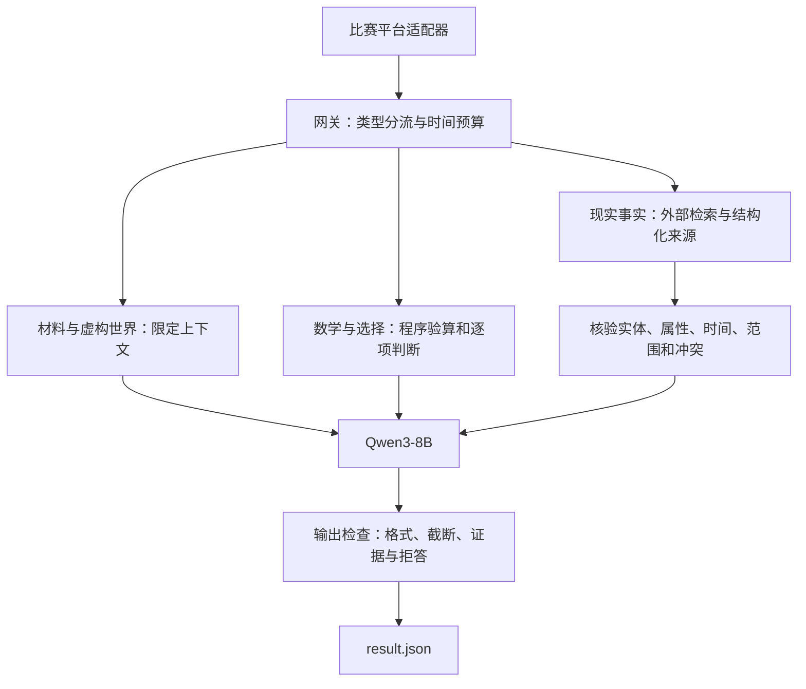

# Qwen3-8B 大模型抗幻觉方案

本仓库保存第七届中国人工智能大赛大模型幻觉赛项的最终工程方案、测试与脱敏结果。最终本地网关版本 **v5.12**；比赛镜像适配器沿用 v5.11 接口。用户反馈已提交成功，但仓库不包含可核实的正式成绩或官方幻觉率下降百分比。

## 方法与架构

未进行 SFT、LoRA、QLoRA 或其他权重训练，因此没有训练学习率、训练轮数、batch size、LoRA rank；Q4_K_M 是推理量化，不是微调。使用官方 Qwen3-8B，llama.cpp Vulkan 部署。DeepSeek 只用于 Search/Fetch 检索，不代替 Qwen 生成。

事实检索保留来源与引句，检查同名消歧和多跳关系，区分出生地与祖籍、历史与当前职位、法律官方语言与主要使用语言。无法绑定证据时说明不足；不把模型自检或自评置信度视为事实核实。部分经过审阅的来源链在小型来源图中保存，并非通用事实覆盖。

护栏包括缺失原始测量值拦截、单位与数值检查、算术和生存函数独立验算、选择题真假与选择方向分离、非选择题选项前缀清理，以及长对话的时间、更正与世界隔离。现实事实、时效问题、核实请求优先搜索；材料、假设世界及可程序验算问题通常不联网。规则分流仍有覆盖不足。

外部访问采用有时效的来源缓存、跨进程锁、访问节奏和限流冷却，区分 HTTP 429 与 maxlag，并服从 Retry-After；缓存来源而非最终答案。所有等待计入总预算。

## 推理配置

- Qwen3-8B Q4_K_M；原部署 RTX 5060 Laptop 8 GB，Vulkan1（换机需重新枚举设备）。
- 上下文 12288 tokens；关闭思考；temperature 0.2、top_p 0.8、top_k 20。
- 默认输出 320 tokens，选择题核验 640；平台四并发，模型单推理槽。
- 引擎预算约 42 秒，网关子进程 45 秒；不保证任何网络条件下的最坏延迟。

## 目录

- `outputs/qwen-v512-dev/`：最终引擎、检索、证据绑定、护栏、自动测试及验收记录。
- `outputs/qwen-v512-launcher/`：启动器与比赛容器复测入口。
- `outputs/qwen-v510-launcher/`：部分历史测试仍引用的兼容脚本。
- `outputs/qwen-baseline/`：原模型部署与来源记录，不含权重和运行凭据。
- `outputs/qwen-deepseek-v5/platform/`：脱敏的平台适配器；保留组织方运行接口。
- `results/`：最终访问修复阶段保留的实验记录，含失败样本。
- `docs/`：含流程图的 Word 方案说明。
- `MANIFEST.json`：归档文件大小与 SHA-256 清单。

## 验证结果与边界

未使用训练数据集。验证包括组织方 21 道演示题、自建题及长对话回归；已参与调试的题不再视为独立隐藏集。

| 检查 | 记录结果 |
|---|---|
| 自动检查 | 348 项通过（不是 348 道问答正确） |
| 组织方 21 题本机回归 | 21/21 调用成功，最长 13.172 秒，不能等同答案全对 |
| HTTP 混合测试 | 13/13 调用及预设内容检查通过，最长 9.11 秒 |
| 四并发长题 | 4/4，通过预设检查，8315 输入 tokens，最长 20.11 秒 |
| 另一组 12 题回归 | 10/12 内容检查通过；仍有实体和限定条件未决 |

以上为小规模本机、部分热缓存结果。最终 v5.12 容器复测与官方评分未取得独立核验记录，不能据此声称正式准确率或幻觉率。历史记录中的公网已启动描述仅代表当时状态；项目服务现已停止。

## 复现与部署

使用 Windows Python 3.10+，核心运行代码主要依赖标准库；原始实现使用 Windows 进程锁与 DPAPI，其他系统需适配。请先阅读源码和验收记录。

1. 从官方 Qwen/Qwen3-8B-GGUF 下载 Q4_K_M 权重至 `work/models/Qwen3-8B-Q4_K_M.gguf`，根据 `outputs/qwen-baseline/provenance.json` 核对来源。安装匹配的 llama.cpp Vulkan 运行时至 `work/runtime/llama-vulkan/`。权重与运行时不随仓库上传。
2. 设置 `DEEPSEEK_API_KEY` 环境变量。原本 DPAPI 私钥未归档，不能直接复用。
3. 检查设备序号后运行 `python outputs/qwen-baseline/launch.py --context 12288`，首次运行会在忽略目录生成本地服务密钥。
4. 设置 `NGROK_DOMAIN` 和 `NGROK_EXE`，单独配置自己的 ngrok 授权后运行 `python outputs/qwen-v512-launcher/start_services.py`。默认占用本地 8080（模型）、8090（网关）、4040（ngrok 管理）。
5. 平台适配器 `model.py` 中配置自己的 `/v1` 地址，并设置 `COMPETITION_API_KEY` 为本地生成的网关密钥；如比赛镜像不支持环境变量，按比赛要求在私人镜像内配置，不要提交到 Git。
6. 本地自动测试：`python -m unittest discover -s outputs/qwen-v512-dev -p "test_*.py"`。部分历史集成测试引用旧目录或本机环境；原验收记录是历史执行结果，不保证干净环境首次运行全部通过。

不包含：任何 API 密钥、ngrok 授权、模型权重、可执行程序、DPAPI 文件、私人运行日志、全部抓取网页缓存和竞赛附件原文。重新部署需自行准备依赖和授权。公开测试记录仅供工程回归，不代表赛方隐藏集。
